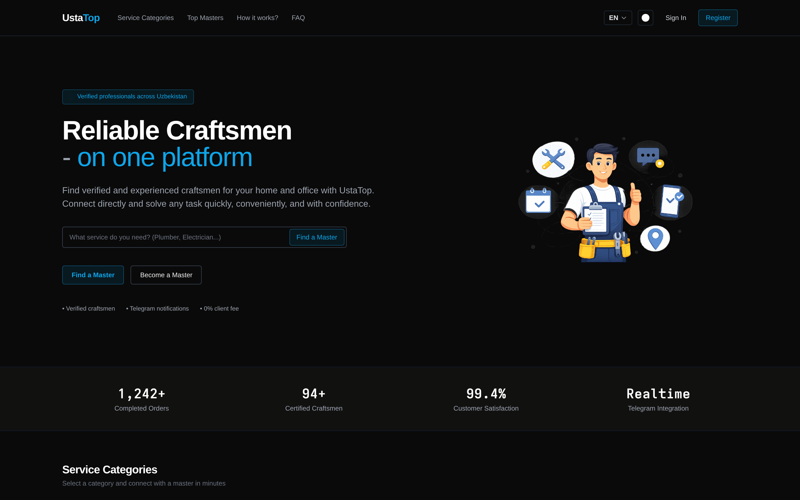
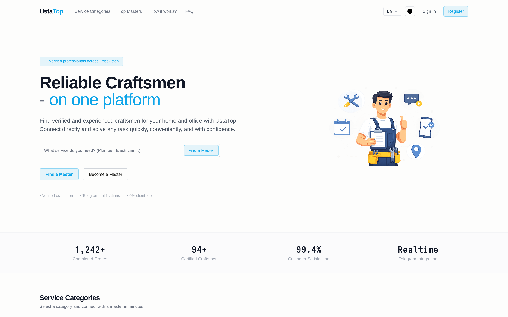
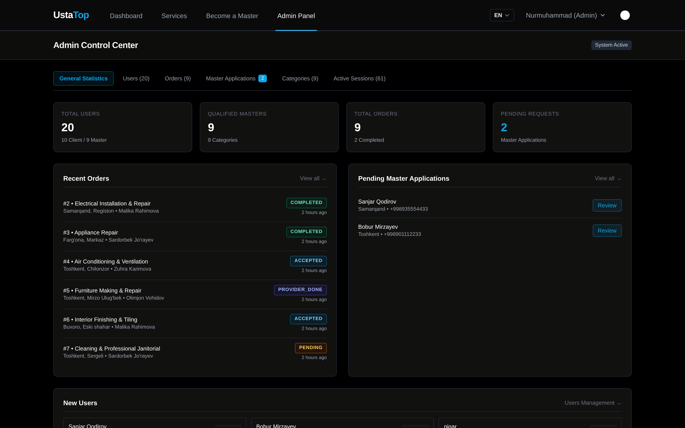
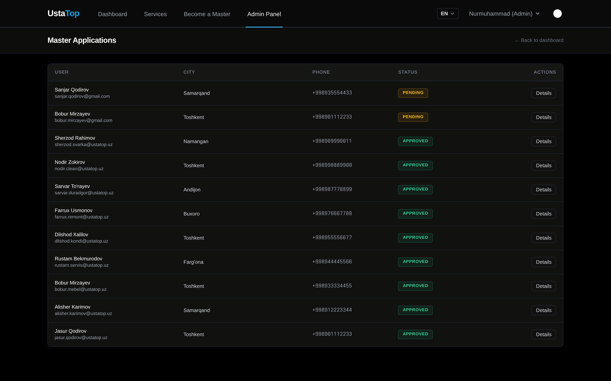
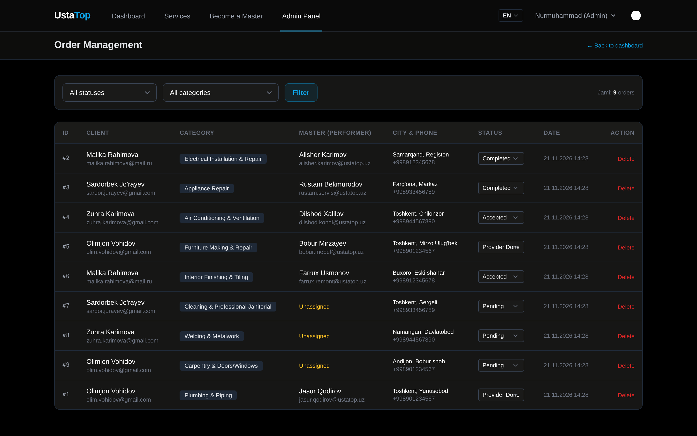
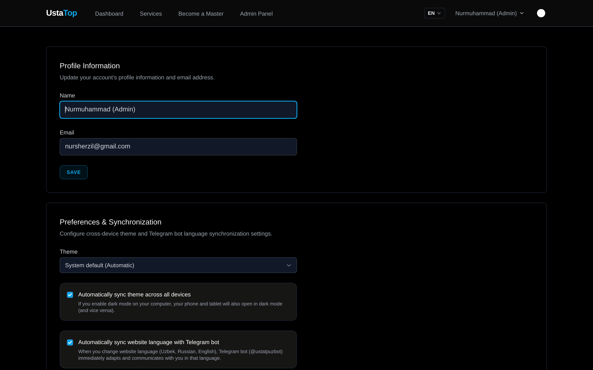
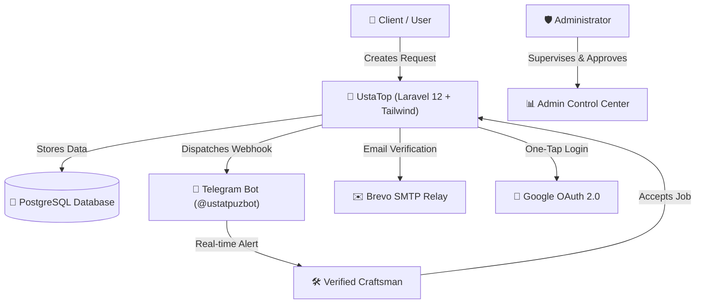

<div align="center">

# UstaTop — Modern On-Demand Craftsman Platform

**A fast, minimalist, multilingual service marketplace connecting clients with verified local craftsmen across Uzbekistan.**

[](https://ustatop-lmze.onrender.com)
[](https://t.me/ustatpuzbot)
[](https://laravel.com)
[](https://tailwindcss.com)
[](https://postgresql.org)
[](LICENSE)

<br/>

**[🌐 Visit Live Website](https://ustatop-lmze.onrender.com)** &nbsp;|&nbsp; **[🤖 Open Telegram Bot](https://t.me/ustatpuzbot)** &nbsp;|&nbsp; **[📖 System Architecture](#system-architecture)**

</div>

---

## 🌟 Overview & Key Features

**UstaTop** is an enterprise-grade service marketplace platform engineered with **Laravel 12**, **Tailwind CSS**, and **PostgreSQL**. It streamlines finding, hiring, and verifying qualified tradespeople (plumbers, electricians, appliance technicians, HVAC specialists, carpenters, etc.) with end-to-end automation.

### 1. 🌐 Dynamic Trilingual Localization (O'zbek, Русский, English)
* **Full Multilingual Categories & Content:** Dynamic translations across Uzbek, Russian, and English for all trade categories and service items.
* **Smart Browser Detection:** Detects visitor browser preference upon first load with fallback and instant header language switching.
* **Cross-Language Order Dispatch:** If a client requests a service in English, craftsmen receive the dispatch in their own preferred language.

### 2. 🤖 Telegram Bot Automation (`@ustatpuzbot`)
* **Instant Order Broadcasting:** When a client places a service request, all verified craftsmen matching that specialty instantly receive a Telegram message with client details, location, and description.
* **Interactive Bot Settings (`/settings`):** Craftsmen and clients can adjust language directly via inline keyboards (`🇺🇿 O'zbek`, `🇷🇺 Русский`, `🇬🇧 English`).
* **Website Sync Mode:** Default automatic synchronization with the user's chosen site language (`sync_telegram_lang`).

### 3. 🎨 Minimalist Dark/Light Mode with Zero-Flicker & Cross-Device Sync
* **Minimalist Aesthetic:** Styled with high-contrast surfaces, clean borders, and cyan glow accents (`#0EA5E9`).
* **Guest-to-User State Preservation:** Any theme selected by an unauthenticated guest persists immediately upon login or registration.
* **Cross-Device Persistence:** Toggle dark mode on desktop, and your phone or tablet immediately renders dark mode.
* **Account Preferences (`/profile`):** Clean management panel without clutter or emojis to configure Telegram bot sync and theme synchronization.

### 4. 🔒 Enterprise Authentication & Fraud Prevention
* **Google OAuth 2.0 Single Sign-On:** Fast, 1-click Google authentication.
* **SMTP Email Verification (Brevo Relay):** Mandatory verification links for password registrations to eliminate fake accounts.
* **Role-Based Access Control (RBAC):** Strict security gating for `client`, `provider` (craftsman), and `admin`.

### 5. 🛠 Full Service Lifecycle Management
* **Order Creation:** Client selects category, city, phone, and comments.
* **Order Acceptance:** Qualified master accepts $\rightarrow$ status changes to `accepted`.
* **Completion Verification:** Craftsman marks work done $\rightarrow$ Client receives notification to verify and confirm completion or re-open.

### 6. 📊 Admin Control Center (`/admin/dashboard`)
* **Real-time Metrics:** Live counts for total users, verified masters, active orders, and active user sessions.
* **Master Verification Pipeline:** Review pending applications with full applicant profiles, contact info, and trade categories before approving or rejecting.
* **Service Orders Supervision:** Real-time visibility into all platform requests.

---

## 📸 Screenshots Showcase

### 🖥️ Landing Page (Dark & Light)
| Dark Mode (Minimalist & Cyan Accents) | Light Mode |
| :---: | :---: |
|  |  |

---

### 🛡️ Admin Control Center & Analytics
| Platform Overview & Statistics | Master Applications Pipeline (Pending Reviews) |
| :---: | :---: |
|  |  |

---

### 📋 Service Requests & Profile Settings
| Real-time Orders Management | Account & Synchronization Settings |
| :---: | :---: |
|  |  |

---

## 🚀 Live Demo Credentials

You can test user roles on the production deployment: **[https://ustatop-lmze.onrender.com](https://ustatop-lmze.onrender.com)**

| Role | Email | Password | Permissions |
| :--- | :--- | :--- | :--- |
| **Craftsman (Master)** | `sherzod.svarka@ustatop.uz` | `1234567pas` | Provider dashboard, order acceptance, completion |
| **Client** | `olim.vohidov@gmail.com` | `1234567pas` | Service requests, Telegram linking, order approval |

---

## 🏗️ System Architecture & Tech Stack



* **Core Framework:** Laravel 12 on PHP 8.4
* **Frontend:** Blade, Tailwind CSS 4, Alpine.js, Vite
* **Database:** PostgreSQL 16
* **Production Web Server:** Nginx + PHP-FPM + Supervisord inside Docker
* **Hosting Infrastructure:** Render.com Dockerized Web Service

---

## 💻 Local Development Setup

### Prerequisites
* PHP 8.2 or higher
* Composer 2.x
* Node.js 20+ and npm
* PostgreSQL or SQLite

### Installation Steps

```bash
# 1. Clone repository
git clone https://github.com/Nurmuhammad-Xusanov/UstaTop.git
cd UstaTop

# 2. Install PHP and Node dependencies
composer install
npm install

# 3. Environment Setup
cp .env.example .env
php artisan key:generate

# 4. Configure Database in .env
DB_CONNECTION=pgsql
DB_HOST=127.0.0.1
DB_PORT=5432
DB_DATABASE=ustatop
DB_USERNAME=postgres
DB_PASSWORD=secret

# 5. Run Migrations & Seeders
php artisan migrate --seed

# 6. Build frontend assets
npm run build

# 7. Start local server
php artisan serve
```

---

## 📦 Automated Deployment (Render.com)

This repository includes a multi-stage `Dockerfile` and `render.yaml` blueprint.

1. Fork or clone this repository to your GitHub account.
2. In [Render Dashboard](https://dashboard.render.com), click **New** $\rightarrow$ **Blueprint**.
3. Select your repository.
4. Render will automatically build the Docker image, run migrations, seed live demo data, and provision an SSL certificate.

---

## 📄 License

This project is licensed under the [MIT License](LICENSE).